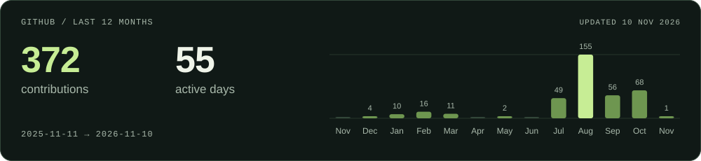

<picture>
  <source media="(max-width: 600px) and (prefers-color-scheme: light)" srcset="assets/hero-mobile-light.svg">
  <source media="(max-width: 600px)" srcset="assets/hero-mobile.svg">
  <source media="(prefers-color-scheme: light)" srcset="assets/hero-light.svg">
  
</picture>

I write Python backends and Telegram apps. My main project is **SchoolPro**, an exam-prep platform I've been building and maintaining since May 2025.

[Email](mailto:kbelakov88@gmail.com) · [Projects](#projects) · [Stack](#stack) · [Activity](#github-activity) · [Disable animation](PROFILE-STATIC.md)

Open to remote work and relocation. Russian C2 · English B2.

## Projects

### SchoolPro

A Telegram platform for UNT exam prep. I'm the sole developer: backend, database, deployment and maintenance.

<picture>
  <source media="(max-width: 600px) and (prefers-color-scheme: light)" srcset="assets/proof-mobile-light.svg">
  <source media="(max-width: 600px)" srcset="assets/proof-mobile.svg">
  <source media="(prefers-color-scheme: light)" srcset="assets/proof-light.svg">
  
</picture>

- Homework, quizzes and student progress, with separate interfaces for five roles.
- Redis caches role lookups; Google Sheets sync lets staff update course content.
- PostgreSQL migrations with backups and rollback plans.

**Python · aiogram · PostgreSQL · SQLAlchemy · Redis · Docker**

How a request moves through SchoolPro

 
<picture>
  <source media="(max-width: 600px) and (prefers-color-scheme: light)" srcset="assets/flow-mobile-light.svg">
  <source media="(max-width: 600px)" srcset="assets/flow-mobile.svg">
  <source media="(prefers-color-scheme: light)" srcset="assets/flow-light.svg">
  
</picture>

Role checks happen in middleware. Domain services handle quizzes, homework and progress; SQLAlchemy handles database access.

### hh_mogger

A Telegram Mini App for job searches. It fetches vacancies from hh.ru, scores matches locally, then generates cover letters for relevant vacancies. Applications are rate-limited.

**Python · React · TypeScript · hh.ru API · OAuth**

### ANOMIA

A released visual novel with turn-based combat and save migrations. I also built a Python pipeline for generating assets with ComfyUI, reviewing contact sheets and adding approved images to the game. Available on itch.io and Patreon, with an English translation.

**Python · ComfyUI**

The repositories are private: client work and commercial projects. I can discuss the architecture and share code where permitted.

## Stack

| | Tools I use |
| :--- | :--- |
| Backend | Python, asyncio, aiogram, FastAPI |
| Data | PostgreSQL, SQLAlchemy, Alembic, Redis |
| Deployment & testing | Docker, Linux, Git, pytest |
| Frontend | React, TypeScript, Telegram Mini Apps |

## GitHub activity

<a href="https://github.com/Keysheero?tab=overview">
  <picture>
    <source media="(max-width: 600px) and (prefers-color-scheme: light)" srcset="assets/activity-mobile-light.svg">
    <source media="(max-width: 600px)" srcset="assets/activity-mobile.svg">
    <source media="(prefers-color-scheme: light)" srcset="assets/activity-light.svg">
    
  </picture>
</a>

Activity visible on my public profile · updated daily.

---

[kbelakov88@gmail.com](mailto:kbelakov88@gmail.com) · Almaty, Kazakhstan
